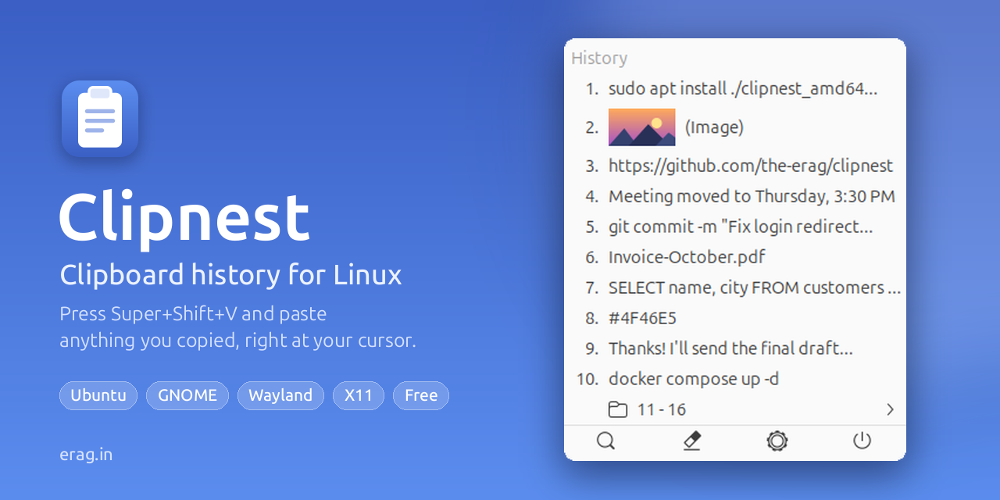
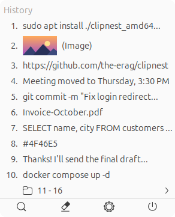
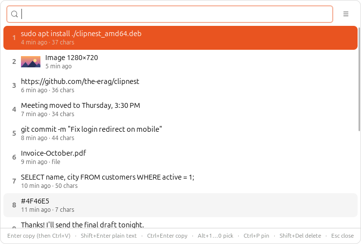
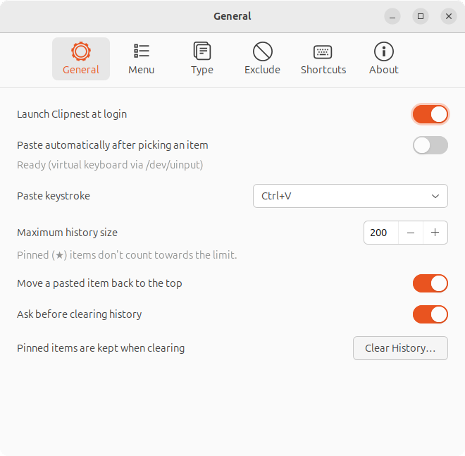

<div align="center">


# Clipnest: Clipboard Manager for Linux

**Never lose something you copied again.**<br>
Clipboard history for Ubuntu and GNOME, on Wayland and X11. Press
<kbd>Super</kbd> + <kbd>Shift</kbd> + <kbd>V</kbd> and paste anything you copied,
right at your cursor.

[](https://github.com/the-erag/clipnest/releases/latest)
[](https://github.com/the-erag/clipnest/releases)
[](https://github.com/the-erag/clipnest/actions/workflows/ci.yml)
[](LICENSE)


**[Download for Ubuntu / Debian (.deb)](https://github.com/the-erag/clipnest/releases/latest/download/clipnest_amd64.deb)**
· [All downloads](https://github.com/the-erag/clipnest/releases/latest)
· [Features](#features)
· [Install](#install)
· [FAQ](#faq)



</div>

## Why Clipnest?

You copy a link, then a command, then a line of text, and the link you needed
is gone. Linux doesn't keep a clipboard history, so every new copy throws the
last one away.

Clipnest remembers everything you copy. Press `Super+Shift+V` and your recent
copies appear in a small menu right where you're typing. Press `1` to paste the
newest, `2` for the one before, or pick any item with the mouse. If you've used
`Win+V` on Windows, it's that, for Linux.

It's free, open source, light on memory, and your history never leaves your
computer.

## Features

- **Remembers everything you copy.** Text, links, images and files, with their
  formatting. Copy the same thing again and it moves back to the top.
- **Opens where you type.** The menu appears just below your text cursor, so
  you paste without hunting around the screen. Without the cursor, it opens at
  the mouse pointer.
- **Paste in one keystroke.** Items are numbered, so `1`…`9` and `0` paste them
  instantly. Older copies are tucked into folders that open on hover.
- **Pastes for you.** Pick an item and Clipnest pastes it into the app you were
  using. No extra `Ctrl+V`.
- **Keeps formatting, or not.** Formatted text pastes formatted. Hold `Shift` to
  paste plain text instead.
- **Image previews.** Copied images show as thumbnails, so you can see which is
  which.
- **Search all your history.** `Super+Shift+F` opens a search box that filters as
  you type.
- **Pin what matters.** Pinned items (★) stay when you clear the history.
- **Private by design.** Everything stays on your computer. Copies that
  password managers mark as secret are skipped, and you can exclude anything
  else, like one-time codes.
- **Top-bar icon.** Click it for the same menu, right below the icon.
- **Light and fast.** Written in Rust. Uses about 22 MB of memory.

## Screenshots

<table>
  <tr>
    <td align="center" width="28%"><br><sub><b>The menu</b>: opens at your cursor</sub></td>
    <td align="center"><br><sub><b>Search</b>: find anything you copied</sub></td>
  </tr>
  <tr>
    <td colspan="2" align="center"><br><sub><b>Preferences</b>: history size, menu layout, formats, exclusions and hotkeys</sub></td>
  </tr>
</table>

## Install

### Ubuntu, Debian, Linux Mint, Pop!_OS

Copy this into a terminal:

```bash
wget -O /tmp/clipnest_amd64.deb https://github.com/the-erag/clipnest/releases/latest/download/clipnest_amd64.deb && sudo apt install /tmp/clipnest_amd64.deb
```

Prefer clicking? [Download the .deb](https://github.com/the-erag/clipnest/releases/latest/download/clipnest_amd64.deb),
then run `sudo apt install ./clipnest_amd64.deb` in the folder you saved it to.

**Then log out and back in once.** That's it. Clipnest starts by itself, sets up
`Super+Shift+V` and `Super+Shift+F`, and starts again every time you log in.

Works on 64-bit Ubuntu 22.04 or newer, Debian 12 or newer, and distributions
based on them.

### Other distributions

Download `clipnest-<version>-linux-x86_64.tar.gz` from the
[releases page](https://github.com/the-erag/clipnest/releases/latest), unpack it
and run:

```bash
./install.sh
```

That installs Clipnest for your user, in `~/.local`. Use `./install.sh --system`
to install it for everyone, in `/usr/local`.

### Build from source

```bash
sudo apt install build-essential pkg-config libgtk-3-dev
curl --proto '=https' --tlsv1.2 -sSf https://sh.rustup.rs | sh -s -- -y
git clone https://github.com/the-erag/clipnest.git && cd clipnest
./install.sh
```

### Turn on auto-paste (Wayland, once)

On Wayland, one app can't type into another, so Clipnest pastes through a small
virtual keyboard. Linux only lets root use one by default. Run this once to
allow it for your user:

```bash
/usr/share/clipnest/enable-autopaste.sh
```

If you installed from the tarball or from source, run
`scripts/enable-autopaste.sh` instead.

This adds a udev rule, like the one Steam adds for game controllers. The
trade-off is that any program you run can then create virtual input devices. If
you skip it, Clipnest copies the item you pick and you press `Ctrl+V` yourself.
On X11, Clipnest pastes with `xdotool` if it's installed.

## How to use

| Press | Where | What happens |
|---|---|---|
| `Super+Shift+V` | anywhere | open the history menu at your text cursor |
| `1` … `9`, `0` | menu | paste item 1…10 |
| `↑` `↓` then `Enter` | menu | paste the selected item |
| `Shift` + number or click | menu | paste as plain text |
| `Esc` | menu | close |
| `Super+Shift+F` | anywhere | open the search box |
| type | search | filter the history (every word must match) |
| `Enter` | search | paste |
| `Shift+Enter` | search | paste as plain text |
| `Ctrl+Enter` | search | copy only, don't paste |
| `Alt+1` … `Alt+0` | search | pick item 1…10 |
| `Ctrl+P` / `Shift+Delete` | search | pin / delete the item |
| click | top-bar icon | open the history menu |
| middle-click | top-bar icon | open the search box |

To change the hotkeys, open **Preferences → Shortcuts**. Preferences also has
history size, menu layout and width, which formats to keep, exclusions and
launch at login.

<details>
<summary><b>Command line</b></summary>

```
clipnest                   start in the background
clipnest history           show the history menu
clipnest search            show or hide the search box
clipnest preferences       open Preferences
clipnest clear             clear the history (asks first)
clipnest quit              stop Clipnest
clipnest setup-shortcuts   register the GNOME hotkeys again
clipnest remove-shortcuts  remove them
clipnest autostart on|off  start at login, or not
clipnest version           print the version
```

</details>

## FAQ

### How do I see my clipboard history on Ubuntu?

Install Clipnest and press `Super+Shift+V` (`Super` is the Windows key). Your
recent copies appear in a menu at your cursor. Ubuntu doesn't keep a clipboard
history by itself.

### Is there a Win+V clipboard history for Linux?

Yes, Clipnest works the same way: one shortcut shows everything you copied, and
picking an item pastes it. The default shortcut is `Super+Shift+V`, and you can
change it to anything you like.

### Does it work on Wayland?

Yes. Clipnest is made for Ubuntu's default GNOME session on Wayland, and works
on X11 too.

### Is my clipboard history private?

Yes. History is stored only on your computer, in `~/.local/share/clipnest/`, and
nothing is sent over the network. Copies that password managers mark as secret
are not saved, and you can add your own exclusion patterns, for example
`^\d{6}$` for one-time codes.

### How do I paste without formatting?

Hold `Shift` while you pick an item, in the menu or in the search box.

### The menu opens at the mouse pointer, not at my text cursor. Why?

Clipnest learns where your text cursor is from its small GNOME helper
extension, which GNOME loads after you log out and back in once. The
extension needs GNOME 45 to 48 (Ubuntu 24.04 LTS has GNOME 46). In apps that
don't report their cursor, the menu opens at the mouse pointer.

### Does it work on KDE, Cinnamon or XFCE?

Clipnest is made and tested for GNOME. On other desktops, bind
`clipnest history` and `clipnest search` to keys in your keyboard settings. If
you try one, [tell us how it went](https://github.com/the-erag/clipnest/issues).

### How do I uninstall it?

```bash
sudo apt remove clipnest
```

If you used `install.sh`, run `./uninstall.sh` (it keeps your history) or
`./uninstall.sh --purge` (it deletes the history too).

<details>
<summary><b>How it works</b></summary>

Wayland keeps apps apart, which a clipboard manager has to work around:

- **Reading the clipboard.** Only the focused window may read the Wayland
  clipboard, so Clipnest runs on XWayland, where GNOME mirrors the clipboard and
  changes can be watched from the background.
- **Hotkeys.** Apps can't grab global keys, so Clipnest registers GNOME custom
  shortcuts. They run `clipnest history`, which passes the command to the
  running Clipnest over D-Bus.
- **Finding the text cursor.** Apps can't see other apps' cursors, but GNOME
  Shell can, because input methods report the cursor to it. The "Clipnest
  helper" extension passes that position on.
- **Top-bar icon.** On Ubuntu, Clipnest uses a tray icon so it can show its own
  menu. Elsewhere it falls back to an AppIndicator; on GNOME without Ubuntu's
  tweaks, install the
  [AppIndicator extension](https://extensions.gnome.org/extension/615/appindicator-support/).

| Path | Contents |
|---|---|
| `~/.config/clipnest/config.json` | preferences |
| `~/.local/share/clipnest/clipnest.db` | history (SQLite) |
| `~/.local/share/clipnest/images/` | copied images (PNG) |

</details>

## Contributing

Bug reports, ideas and pull requests are welcome. See
[CONTRIBUTING.md](CONTRIBUTING.md) to get started, and please follow the
[code of conduct](CODE_OF_CONDUCT.md). Found a security problem? See
[SECURITY.md](SECURITY.md).

If Clipnest saves you time, **give it a star ⭐**. It helps other people find
it.

## License

[MIT](LICENSE) © 2026 [erag](https://erag.in)

<div align="center"><sub>Made by <a href="https://erag.in">erag</a></sub></div>
